<p align="center">
  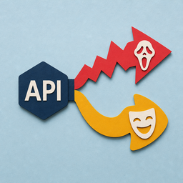
</p>

<h1 align="center">Predict Film Category</h1>

<p align="center">
  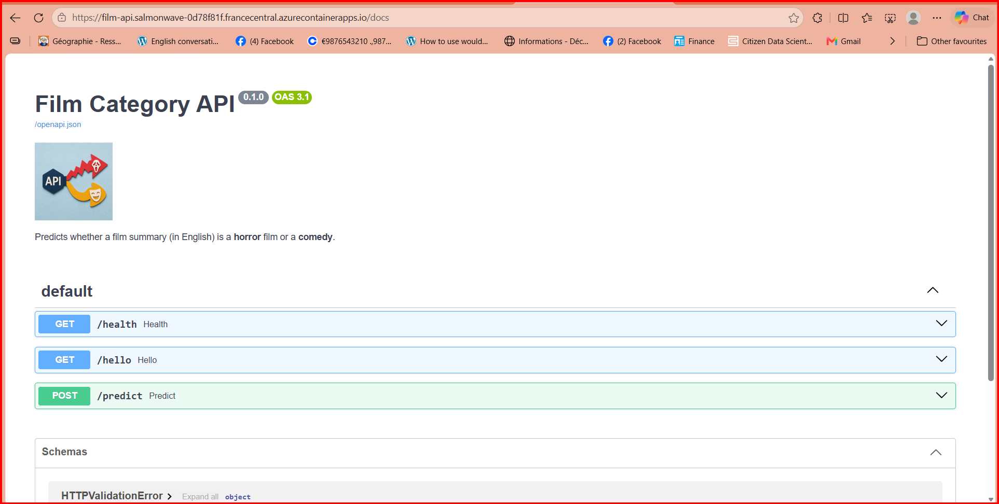
</p>

<p align="center">
  From a notebook to a public API: a model that tells whether a film summary is a <strong>horror</strong> film or a <strong>comedy</strong>,
  tested automatically, packaged in a Docker image, built by GitHub Actions and deployed on Azure.
</p>

<p align="center">
  <strong>Live demo:</strong>
  <a href="https://film-api.salmonwave-0d78f81f.francecentral.azurecontainerapps.io/docs">Film Category API - Swagger UI</a>
</p>

> The API runs on Azure Container Apps. Open the test page, choose `POST /predict`, click **Try it out**, paste a film summary in English and press **Execute**.
> The app is deleted at the end of the project (see [Cleaning up](#cleaning-up)), so the link stops working after that.

## Table of contents

1. [Overview](#1-overview)
2. [Project structure](#2-project-structure)
3. [Installation](#3-installation)
4. [Part 1: the notebook and the model](#4-part-1-the-notebook-and-the-model)
5. [Part 2: the API](#5-part-2-the-api)
6. [Automatic tests and quality gate](#6-automatic-tests-and-quality-gate)
7. [Docker](#7-docker)
8. [GitHub Actions](#8-github-actions)
9. [Deployment on Azure](#9-deployment-on-azure)
10. [Documentation](#10-documentation)
11. [Troubleshooting](#11-troubleshooting)
12. [Limits and possible improvements](#12-limits-and-possible-improvements)

---

## 1. Overview

<p align="center">
  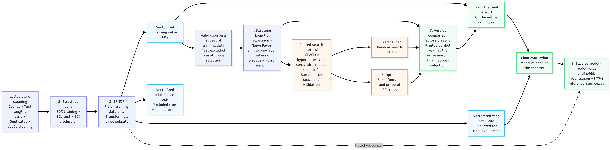
</p>

| Step | What happens | Tools |
|---|---|---|
| 1. Model | Audit and cleaning, 60/20/20 split, TF-IDF, baselines, hyperparameter search, honest verdict on the test set | pandas, spaCy, scikit-learn, Keras, KerasTuner, Optuna |
| 2. API | `/health` and `/predict`, input validation with clear error messages | FastAPI, pydantic, uvicorn |
| 3. Checks | Automatic tests and a quality gate that refuses a bad model | pytest, `config.yaml`, `check_quality.py` |
| 4. Container | Light image, same answers as on the local machine | Docker |
| 5. Robot | `test`, then `image`, then `publier` (push to the registry) | GitHub Actions |
| 6. Online | Public address, manual deployment by commit ID, rollback | Azure Container Registry, Azure Container Apps |

**Live deployment** (Azure Container Apps, France Central):

| Page | Link |
|---|---|
| Test page (Swagger UI) | [`/docs`](https://film-api.salmonwave-0d78f81f.francecentral.azurecontainerapps.io/docs) |
| Documentation (ReDoc) | [`/redoc`](https://film-api.salmonwave-0d78f81f.francecentral.azurecontainerapps.io/redoc) |
| Health check (status, model version, commit ID) | [`/health`](https://film-api.salmonwave-0d78f81f.francecentral.azurecontainerapps.io/health) |
| Home page | [`/`](https://film-api.salmonwave-0d78f81f.francecentral.azurecontainerapps.io/) |

**Result of the model** (single measurement on the test set): F1 = **0.849** on 469 texts (noise margin about ±0.03).
The API returns the category, the probability and the model version.

---

## 2. Project structure

```text
predict-film-category/
├── .github/workflows/ci.yml       # GitHub Actions: test, image, publier
├── data/                          # source dataset (film summaries)
├── model/                         # model.keras, tfidf.joblib, metrics.json, reference_sample.csv
├── notebook/                      # predFilm.ipynb (8 stages) and TensorBoard logs
├── resources/                     # logo, diagrams, screenshots and briefs
├── src/
│   ├── app.py                     # FastAPI application
│   └── static/                    # served by the API at /static
│       ├── logo.png               # logo (256x256)
│       ├── favicon.ico            # browser tab icon
│       └── training_curves.png    # loss and accuracy of the final model
├── tests/
│   ├── conftest.py
│   ├── test_api.py                # 9 automatic tests
│   └── fake_model/metrics.json    # invented bad model (the gate must refuse it)
├── tools/
│   ├── tree.py                    # prints the project tree
│   └── export_training_curves.py  # TensorBoard logs -> src/static/training_curves.png
├── check_quality.py               # quality gate
├── config.yaml                    # quality thresholds
├── Dockerfile
├── .dockerignore
├── pytest.ini
├── requirements.txt               # full environment (notebook)
├── requirements-api.txt           # API only (Docker image)
├── requirements-dev.txt           # tests and quality gate
├── PLAN.md                        # planning: tasks, workload, resources, dates
├── PROCEDURE_MISE_EN_PRODUCTION.md  # deployment procedure + version log
└── FIN_DE_VIE.md                  # end-of-life procedure
```

Caches, logs and local files (`.pytest_cache/`, `notebook/my_log_dir/`, `kt_logs/`, `.env`) are not part of the project and stay out of Git.

---

## 3. Installation

Requirements: Python 3.11, Git, Docker (for the container steps) and an Azure account (for the deployment).

```bash
git clone https://github.com/<user>/predict-film-category.git
cd predict-film-category

python -m venv venv
source venv/bin/activate              # Windows: venv\Scripts\activate
pip install -r requirements.txt
python -m spacy download en_core_web_sm
```

For the API only, `pip install -r requirements-api.txt` is enough. For the tests, use `requirements-dev.txt`.

> The versions in `requirements-api.txt` must match the ones recorded in `model/metrics.json` (`library_versions`),
> otherwise the saved `.keras` model or the TF-IDF file may not load.

---

## 4. Part 1: the notebook and the model

The notebook `notebook/predFilm.ipynb` has 8 stages:

1. **Audit and cleaning**: counts, text lengths, `strip`, duplicates, spaCy cleaning (lowercase lemmas, no stop words)
2. **Dataset split**: 60 % training, 20 % test, 20 % production (kept aside), same class proportions in each part
3. **TF-IDF**: vocabulary learned on the training set only
4. **Baselines**: logistic regression, Naive Bayes and a simple network, F1 on 5 seeds, with the noise margin
5. **KerasTuner**: random search, 20 trials
6. **Optuna**: same settings, same ranges, same 20 trials
7. **Verdict**: comparison taking the noise margin into account, then one single measurement on the test set
8. **Saving** to `model/`

```bash
jupyter lab                           # open notebook/predFilm.ipynb and run all cells
tensorboard --logdir notebook/my_log_dir    # then open http://localhost:6006
```

Files produced in `model/`:

| File | Content |
|---|---|
| `model.keras` | the trained network |
| `tfidf.joblib` | the fitted TF-IDF vectorizer |
| `metrics.json` | model version, test F1, test size, library versions (UTF-8) |
| `reference_sample.csv` | small sample of reference data |

<p align="center">
  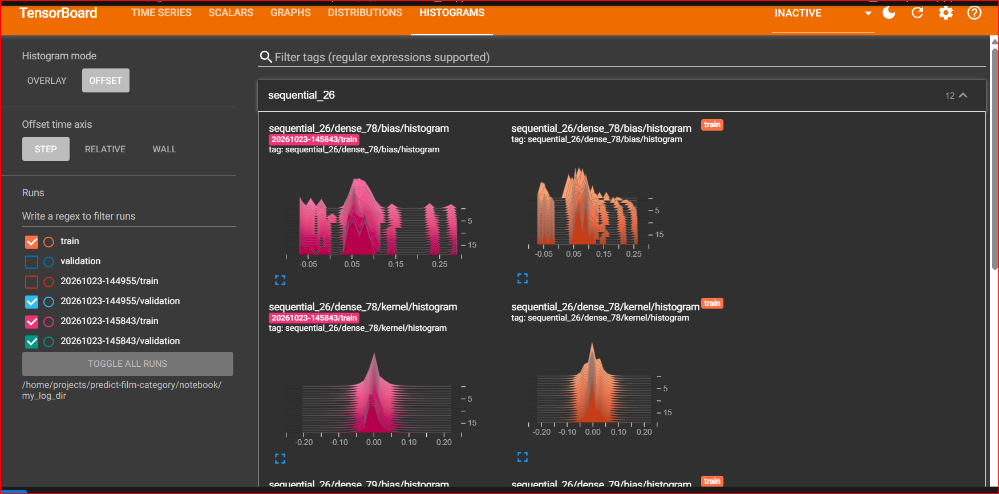
</p>

### Export the training curves

The home page of the API shows the learning curves of the final model. The script reads the TensorBoard logs and saves them as a picture:

```bash
pip install matplotlib                                    # needed only for this script
python tools/export_training_curves.py notebook/my_log_dir/<session-folder>
python tools/export_training_curves.py notebook/my_log_dir/<session-folder> --list   # shows which curves the logs contain
```

- `<session-folder>` is the date-time folder created by a notebook run (for example `20261028-110802`). The `final_model` folder inside it is accepted too.
- The picture is saved as `src/static/training_curves.png`. Commit it: it is copied into the Docker image with `src/`.
- Run the script again after each retraining, then rebuild and redeploy to show the new curves online.

<p align="center">
  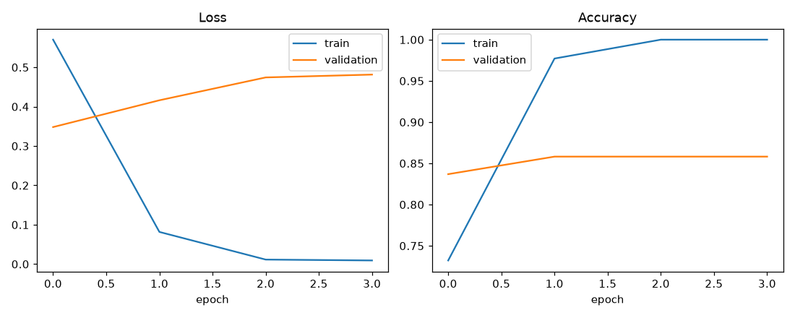
</p>

### Cleaning step shared with the API

The TF-IDF was fitted on cleaned text, so the API applies the **same** cleaning (`clean_doc` in `src/app.py`) before predicting.
If you change the cleaning in the notebook, change it in the API too, then retrain and rebuild.

---

## 5. Part 2: the API

Start it from the project root:

```bash
uvicorn src.app:app --reload --port 8000
```

If your model folder is elsewhere, set `MODEL_DIR` (default: `model/` at the project root).

| Route | Method | Description |
|---|---|---|
| `/` | GET | home page with the logo and the training curves |
| `/health` | GET | status, model version and commit ID |
| `/predict` | POST | category, probability and version for a film summary |
| `/docs` | GET | interactive test page (Swagger) |
| `/redoc` | GET | documentation |
| `/static/...` | GET | logo, favicon and training curves |

**Valid request** (an English summary of 20 to 5000 characters):

```bash
curl -X POST http://127.0.0.1:8000/predict \
  -H "Content-Type: application/json" \
  -d '{"text": "A group of friends is hunted by a masked killer in an abandoned cabin in the woods."}'
```

```json
{"category": "horror", "probability": 0.93, "version": "1.0.0"}
```

The values above are an example. Your real answer depends on the model.

**Invalid request** (empty, or too short) returns a clear 422 message:

```bash
curl -X POST http://127.0.0.1:8000/predict -H "Content-Type: application/json" -d '{"text": "Scary movie"}'
```

```json
{"error": "Requête invalide", "details": ["text: String should have at least 20 characters"]}
```

<p align="center">
  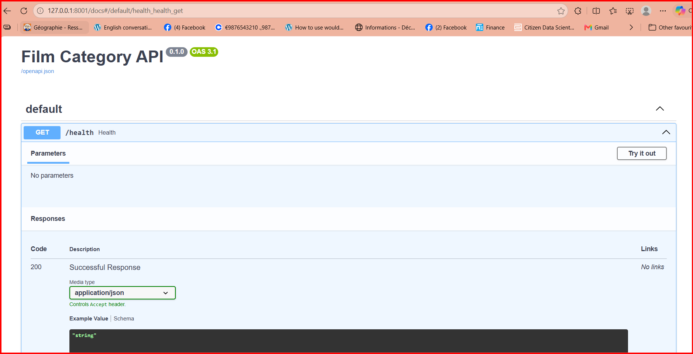
</p>

### Logo and static files

The API serves the files of `src/static/` at `/static`:

| File | Used for |
|---|---|
| `logo.png` | the home page, the test page `/docs`, the documentation `/redoc` and this README |
| `favicon.ico` | the icon of the browser tab (`/favicon.ico`, also used by `/docs`) |
| `training_curves.png` | the learning curves shown on the home page |

To change the logo, save a square PNG (256x256 is enough, keep it under about 100 KB) as `src/static/logo.png`, and an icon as `src/static/favicon.ico`.
A large image slows the page down and makes the Docker image heavier.

Keep these files inside `src/` and commit them: the Dockerfile copies only `src/` and `model/`, and `resources/` is not part of the image.

---

## 6. Automatic tests and quality gate

```bash
pip install -r requirements-dev.txt
pytest -v                                    # expect 9 passed
python check_quality.py                      # model accepted
python check_quality.py --metrics tests/fake_model/metrics.json   # fake model refused (exit code 1)
```

**The 9 tests** check that the API responds, that a valid text works, that an empty text, a very short text, a missing field and a text without usable words are refused,
that the metrics meet the thresholds, that the reference sample goes through the API with a minimum accuracy, and that the gate refuses a fake model.

**Thresholds** (`config.yaml`):

| Key | Value | Meaning |
|---|---|---|
| `min_f1` | 0.81 | minimum test F1 |
| `min_test_size` | 300 | minimum number of test texts |
| `min_reference_accuracy` | 0.85 | minimum accuracy on the reference sample (smoke test) |

> **Why 0.81?** It is the test F1 (0.849) minus the noise margin (about 0.03), rounded down:
> a model below it is worse than ours by more than random noise, while a normal retraining is not refused by chance.

<p align="center">
  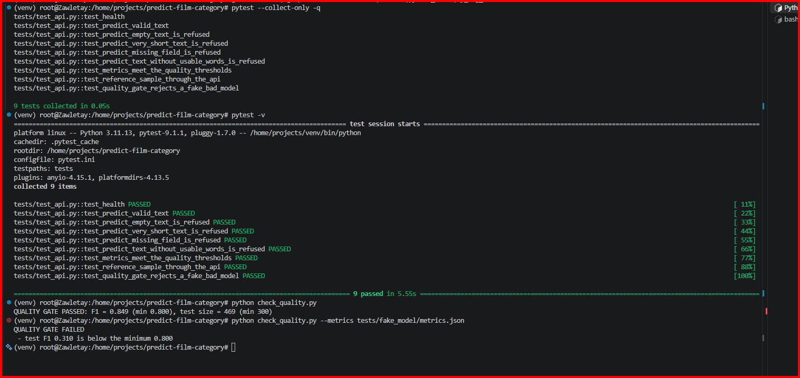
</p>

---

## 7. Docker

```bash
docker build -t film-api:local --build-arg GIT_COMMIT=$(git rev-parse HEAD) .
docker run --rm -p 8000:8000 film-api:local
docker images film-api                       # note the image size
```

Then repeat the three cases on http://localhost:8000/docs: a valid text, an invalid text, a very short text.

- Base image `python:3.11-slim` with `tensorflow-cpu` and pinned versions.
- Only `src/` (the code and the `static/` files) and `model/` are copied; notebooks, data, tests, resources and logs are excluded by `.dockerignore`.
- The commit ID is passed with `GIT_COMMIT` and returned by `/health`.
- The container runs as a normal user and has a health check.

---

## 8. GitHub Actions

The workflow `.github/workflows/ci.yml` runs on every push:

| Job | Starts when | What it does |
|---|---|---|
| `test` | always | installs the project, runs the quality gate and the tests |
| `image` | `test` succeeded | builds the image and checks that the API starts inside (`/health`, commit ID, `/predict`) |
| `publier` | `image` succeeded, on `main` | logs in to the Azure registry and pushes the image tagged with the commit ID |

**Secrets** to create in the repository (Settings, then Secrets and variables, then Actions):

| Secret | Value |
|---|---|
| `REGISTRY_LOGIN_SERVER` | `<registry>.azurecr.io` |
| `REGISTRY_USERNAME` | registry admin user |
| `REGISTRY_PASSWORD` | registry admin password |

Passwords are never written in the code, in files or in a chat.

**Proof that the robot is useful:** raise `min_f1` above what the model can reach (for example `0.99`) and push. The `test` job turns red and `image` does not start. Restore the right threshold and everything turns green again.

---

## 9. Deployment on Azure

On the training account the role is *Contributor*: the robot can build the image and store it in the registry, but cannot order Azure to put it online.
So the deployment is done **by hand**, with the commit ID of the version to put online.

**Where to run what:**

| Command | Where |
|---|---|
| `git`, `docker` (build, run, push) | your own terminal (WSL), inside the project folder |
| `az` (registry, Container App) | Azure Cloud Shell or your own terminal after `az login` |

Azure Cloud Shell has no copy of the repository and no Docker engine: `git rev-parse` and `docker build` fail there.

### Registry

1. Create an Azure Container Registry (Basic plan, unique lowercase name without dashes).
2. In *Access keys*, turn on the **admin user** (use it instead of the managed identity option).

<p align="center">
  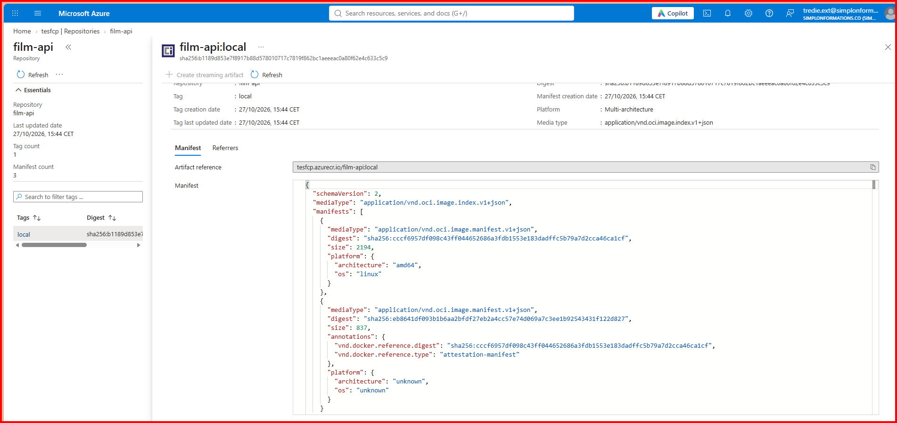
</p>

### Container App

```bash
az login --use-device-code
az containerapp env create --name film-env --resource-group <resource-group> --location <region>

read -s -p "Registry password: " ACR_PASSWORD; echo
az containerapp create \
  --name film-api --resource-group <resource-group> --environment film-env \
  --image <registry>.azurecr.io/film-api:<commit-id> \
  --registry-server <registry>.azurecr.io \
  --registry-username <user> --registry-password "$ACR_PASSWORD" \
  --target-port 8000 --ingress external \
  --cpu 1 --memory 2.0Gi --min-replicas 1 --max-replicas 1

az containerapp show --name film-api --resource-group <resource-group> \
  --query properties.configuration.ingress.fqdn --output tsv      # public address
```

Open `https://<address>/docs` or `/health`. For this project the public address is [https://film-api.salmonwave-0d78f81f.francecentral.azurecontainerapps.io](https://film-api.salmonwave-0d78f81f.francecentral.azurecontainerapps.io), for example [`/docs`](https://film-api.salmonwave-0d78f81f.francecentral.azurecontainerapps.io/docs). Less than 2 GB of memory makes TensorFlow restart in a loop.

<p align="center">
  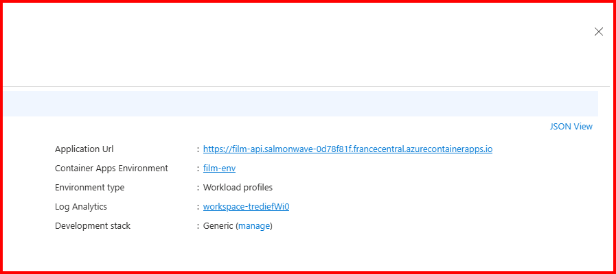
</p>

### Release a new version, and roll back

**Step 1: set the resource group.** Shell variables are lost when you open a new terminal or reconnect Cloud Shell.
An empty `$RG` turns `--resource-group $RG` into `--resource-group` with no value, and Azure answers `expected one argument`.

```bash
echo "RG=[$RG]"                      # RG=[] means the variable is empty
az account show                      # not logged in? run: az login --use-device-code
az containerapp list --query "[].{name:name, resourceGroup:resourceGroup}" --output table
RG=<your-resource-group-name>        # the exact name shown in the table
```

**Step 2: check that the image tag exists in the registry.**

```bash
az acr repository show-tags --name <registry> --repository film-api --orderby time_desc --output table
```

- The tag is listed: go to step 4.
- The tag is missing: the update would fail with `MANIFEST_UNKNOWN`. Go to step 3.

**Step 3: get the final image into the registry** (only if the tag is missing).

- **A. Let the robot do it (recommended).** After a push to `main` with three green jobs, the `publier` job pushes the image tagged with the full commit ID.
  Use that commit ID as the tag in step 4. `/health` will then show it.

  ```bash
  git rev-parse HEAD                 # run in the project folder, not in Cloud Shell
  ```

- **B. Push a tag by hand** from your own terminal, with the Docker engine running (`sudo service docker start`):

  ```bash
  docker build -t film-api:v2 --build-arg GIT_COMMIT=$(git rev-parse HEAD) .
  docker login <registry>.azurecr.io --username <user>
  docker tag film-api:v2 <registry>.azurecr.io/film-api:v2
  docker push <registry>.azurecr.io/film-api:v2
  ```

  If the push breaks halfway, retry it: finished layers are skipped. Without `--build-arg GIT_COMMIT`, `/health` shows `commit: unknown`.

**Step 4: update the app.** This version stops with a clear message if the variable is empty:

```bash
az containerapp update --name film-api --resource-group "${RG:?RG is empty, set it first}" \
  --image <registry>.azurecr.io/film-api:<commit-id>
```

Azure creates a new revision, which takes a minute or two while TensorFlow loads the model.

**Step 5: check the result.**

```bash
az containerapp revision list --name film-api --resource-group "$RG" --output table
az containerapp logs show --name film-api --resource-group "$RG" --follow
curl https://film-api.salmonwave-0d78f81f.francecentral.azurecontainerapps.io/health
```

The newest revision must be active and healthy, and `/health` must show the new commit ID. Open `/docs` and repeat the three cases (valid, empty, very short).

**Roll back.** Run the step 4 command again with the previous commit ID. `/health` shows the old commit ID again, and routes added since (such as `/hello`) disappear.
Every deployment and rollback is recorded in the version log of [`PROCEDURE_MISE_EN_PRODUCTION.md`](PROCEDURE_MISE_EN_PRODUCTION.md).

**If it fails:**

| What you see | Cause and fix |
|---|---|
| `expected one argument` | `$RG` is empty: run `echo "RG=[$RG]"` and set it again (step 1) |
| `The containerapp 'film-api' does not exist` | wrong resource group or subscription, or the app was deleted: run `az containerapp list --output table` and `az account list --output table`; if the app is gone, create it (see *Container App* above, it needs an existing tag) |
| `MANIFEST_UNKNOWN` | the tag is not in the registry: check step 2 |
| `unauthorized` when pulling the image | the app lost its registry login: type the password with `read -s -p "Registry password: " ACR_PASSWORD; echo`, then run `az containerapp registry set --name film-api --resource-group "$RG" --server <registry>.azurecr.io --username <user> --password "$ACR_PASSWORD"` |
| `/health` still shows the old commit | the new revision is not live yet: wait and check the revision list |
| the revision keeps restarting | memory below 2 Gi, or the model fails to load: read the logs |

Never paste the registry password in a file or in a chat.

### Cleaning up

A registry is billed as long as it exists, even if nobody uses it. When the project is finished, note the estimated cost, then delete the app, its environment and the registry.
**Never delete a shared resource group.**

```bash
az containerapp delete --name film-api --resource-group <resource-group> --yes
az containerapp env delete --name film-env --resource-group <resource-group> --yes
az acr delete --name <registry> --resource-group <resource-group> --yes
```

The full end-of-life checklist is in [`FIN_DE_VIE.md`](FIN_DE_VIE.md).

---

## 10. Documentation

| File | Content |
|---|---|
| [`PLAN.md`](PLAN.md) | planning: tasks, dependencies, estimated and actual workload, resources, planned dates, budget, risks |
| [`PROCEDURE_MISE_EN_PRODUCTION.md`](PROCEDURE_MISE_EN_PRODUCTION.md) | step-by-step deployment, rollback, troubleshooting and the **version log** |
| [`FIN_DE_VIE.md`](FIN_DE_VIE.md) | when and how to retire the service: what to delete, keep or archive |
| `resources/briefs/` | the training briefs (PDF) |

### Screenshots

| Image pushed | Container App creation | App running |
|:---:|:---:|:---:|
| 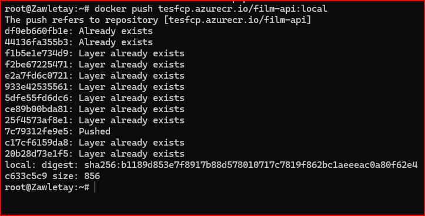 | 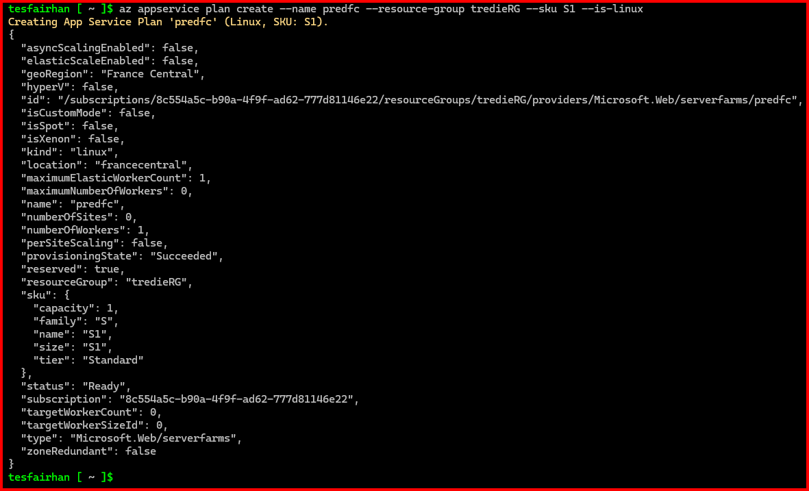 | 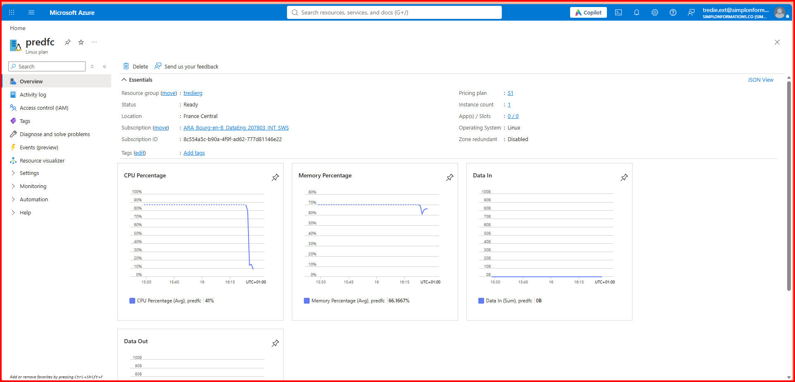 |

---

## 11. Troubleshooting

| What you see | Cause | Fix |
|---|---|---|
| `No module named 'src'` or `'check_quality'` | wrong folder or no `pytest.ini` | run from the project root |
| `collected 0 items` | tests not in `tests/` or not named `test_*.py` | move the files, check the names |
| `FileNotFoundError ... model.keras` | model folder not found | set `MODEL_DIR` or check `model/` |
| `.keras` or TF-IDF fails to load | different library versions | pin the versions from `metrics.json` |
| `Cannot connect to the Docker daemon` | engine not running | `sudo service docker start` |
| `authentication required` on `docker push` | not logged in to the registry | `docker login <registry>.azurecr.io` with the admin user |
| `MANIFEST_UNKNOWN` | image or tag missing in the registry | `az acr repository show-tags --name <registry> --repository film-api` |
| `roleAssignments/write` refused | role cannot grant rights | use the registry admin user |
| Container restarts in a loop | not enough memory | give 2 GB, read `az containerapp logs show` |
| `Not Found` on the public address | the address alone is not a route | add `/health` or `/docs` |
| `expected one argument` on `az containerapp update` | `$RG` is empty (new terminal) | `echo "RG=[$RG]"`, then set `RG=` again |
| `The containerapp 'film-api' does not exist` | wrong resource group or subscription, or the app was deleted | `az containerapp list --output table`, `az account list --output table`; create the app if it is gone |
| `Cannot connect to the Docker daemon` in Cloud Shell | Cloud Shell has no Docker engine | run `docker` in your own terminal; use Cloud Shell only for `az` |
| `fatal: not a git repository` in Cloud Shell | the repository is on your own machine | run `git` in the project folder |
| GitHub asks for a password on `git push` | passwords are no longer accepted | use a personal access token (scopes `repo` and `workflow`), the GitHub CLI or an SSH key |
| `publier` skipped or red | not on `main`, or a secret name or value is wrong | check the branch and the three secrets |
| `No event file found` or `KeyError` with `export_training_curves.py` | wrong log folder | pass the session folder, run with `--list` to see the curves |

---

## 12. Limits and possible improvements

- **Manual deployment.** The Contributor role cannot give the robot the right to deploy. Automatic deployment (CD) would need a role assignment for the pipeline, for example a service principal or federated credentials, plus a deployment job.
- **English only.** The model was trained on English summaries and the API cleans text with an English spaCy model.
- **Reference sample.** It comes from the training data, so it checks that the deployed files work, not how well the model generalises. The test F1 does that.
- **No authentication or rate limit** on the API, and no monitoring of the answers over time.
- **Image size.** TensorFlow makes the image large; a lighter runtime (for example ONNX) could reduce size and start-up time.
- **Cold start.** Loading TensorFlow takes a minute; the app keeps one replica running to avoid it, which costs a little.
- **Model updates** are manual: retrain in the notebook, run the tests, push, then deploy by commit ID.
